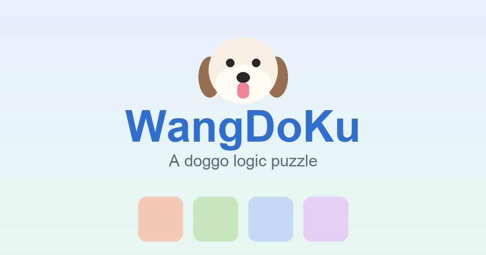

# WangDoKu 🐶 — a free dog logic puzzle



A cute, dog-themed logic puzzle you play right in the browser — the same family as
**Star Battle** and the LinkedIn **Queens** puzzle. Pure HTML/CSS/JS, no build step to
play, no dependencies, no tracking beyond optional analytics.

▶️ **Play:** https://wangdoku.netlify.app

> WangDoKu is an independent, fan-made game and is **not affiliated with** Pawdoku or
> Meowdoku. The name **WangDoKu** ("汪" = *woof* in Chinese) is kept untranslated in every
> language.

## Rules

- One pup 🐶 per **color region**
- One pup per **row** and per **column**
- No two pups **touch** — not even diagonally

## Controls

- **Tap / click** a cell: empty → ❌ (mark as empty) → 🐶 → empty
- **Long-press / right-click**: place or remove a pup directly
- Toolbar: 💡 Hint · ↩︎ Undo · 🧹 Clear · 🔄 New
- **Four difficulties** — Beginner (6×6), Easy & Medium (8×8), Hard (10×10) — graded by the
  *reasoning* they require, not just board size
- **Stats** kept in `localStorage`: current-puzzle timer + today / all-time solved, per
  difficulty (today resets across days). Timer starts on your **first move**.
- **Shareable puzzles**: "🔗 Copy this puzzle's link" encodes the whole board into a short
  `?p=` URL param, so a friend opens the *exact same* board.
- **Smart hints** that teach the logic (see below), a first-win "add to home screen" prompt
  (PWA), and celebratory reveal / win animations.

## Internationalization & SEO (18 languages)

The UI is translated at runtime via `data-i18n` attributes (`js/i18n.js`), auto-detecting
the browser language. For real multilingual SEO, each language also has its **own static
page** with localized `<title>`, meta, Open Graph, JSON-LD and footer copy:

- English (x-default) at `/`, others at `/<lang>/` (e.g. `/ja/`, `/es/`, `/zh-Hant/`)
- Languages: en, zh-Hant, zh-Hans, ja, ko, es, fr, de, pt, ru, id, vi, th, hi, tr, it, pl, ar
  (Arabic is RTL)

**These pages are generated — do not edit them by hand.** Edit the source, then rebuild:

- Layout/markup → `index.template.html` (uses `{{PLACEHOLDER}}`; asset paths are absolute)
- Per-language SEO copy → `seo-content.js`
- Then run the build (regenerates the 18 pages **and** `sitemap.xml`):

```bash
node build-i18n.js
```

## Run locally

Just open `index.html` in a browser. If your browser blocks local file loads, serve it:

```bash
python3 -m http.server 8777
# then open http://localhost:8777
```

## Project structure

```
index.template.html   page template ({{PLACEHOLDER}} slots, absolute asset paths)
seo-content.js        per-language SEO copy (title/description/OG/footer/FAQ) — build input
build-i18n.js         generates /index.html, /<lang>/index.html and sitemap.xml
index.html            GENERATED English page (do not edit)
<lang>/index.html     GENERATED localized pages (do not edit)
styles.css            styles + animations (board reveal, win confetti/bounce)
js/i18n.js            18-language dictionary, browser-language detect, runtime translation
js/solver.js          solver (counts solutions to verify uniqueness)
js/difficulty.js      difficulty rater (by the reasoning technique required)
js/generator.js       puzzle generator (solution → grow regions → refine to unique → rate)
js/game.js            game state, conflict detection, win check, teaching hint engine
js/main.js            UI wiring, difficulty, stats, rendering, share links, PWA
sw.js                 service worker (network-first, offline fallback)
manifest.webmanifest  PWA manifest
```

## How unique solutions are guaranteed

Random color blobs almost never yield a unique solution on larger boards, so WangDoKu uses
**post-generation refinement**:

1. Generate a legal solution S and carve connected color regions by flood-growth.
2. While another solution exists, recolor a key cell of that alternate into a neighboring
   region to break it (keeping every region connected and S's pup intact).
3. Repeat until only S remains.

Stable from 6×6 to 10×10 (~0.2s at 10×10).

## Smart hints

The hint engine works on the *visible* board and finds the easiest next step, in order:
remove a wrong pup → un-mark a wrong ❌ → mark cells excluded by existing pups → a
"naked single" (only one spot left in a color/row/column) → a one-ply contradiction (with
the doomed color/row/column highlighted). When only deeper (multi-step) reasoning is left,
it honestly says so rather than faking a one-line explanation.

## Contributing

Issues and PRs welcome. Adding or improving a translation? Edit `js/i18n.js` (UI strings)
and `seo-content.js` (page copy), then run `node build-i18n.js` and commit the regenerated
pages. Keep the brand name **WangDoKu** untranslated.

## License

[GPL-3.0](LICENSE) © the WangDoKu authors.
